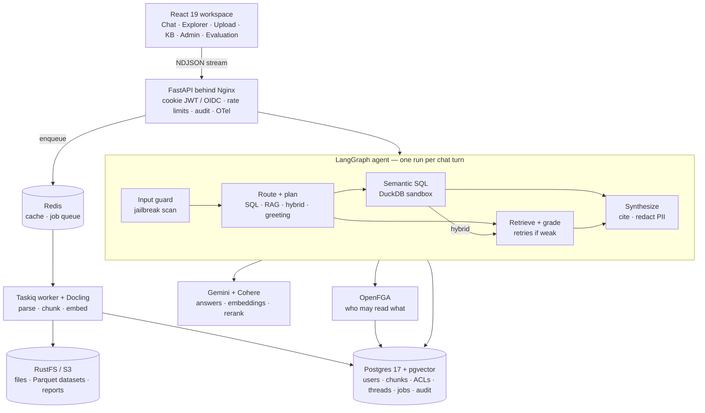

<div align="center">

# FinSight

### Self-hosted, permission-aware AI assistant for company documents and data

Ask questions in plain English. FinSight answers from documents **and** spreadsheets, cites its sources, and only uses data the person asking is allowed to see.

[](.github/workflows/ci.yml)


[Quick start](#quick-start) · [Architecture](#architecture) · [Security](#security-model) · [Evaluation](#evaluation) · [Deployment](deploy/README.md) · [Project status](#project-status)

</div>

---

## Why FinSight

Connecting an LLM to company data is easy. Doing it so an intern can't read the CEO's payroll file, and every answer can be traced, is the hard part — and it's what blocks most internal AI rollouts.

| Problem | How FinSight handles it |
| --- | --- |
| Knowledge is split across Finance, HR, Marketing, Engineering | One chat interface over every department's documents and CSVs |
| Generic RAG chatbots leak data across a shared index | Authorization (OpenFGA) runs **before** retrieval; unauthorized chunks never reach the model |
| Spreadsheet questions need an analyst | Governed NL→SQL over a semantic layer, executed in a sandbox, returned as a table + chart |
| Nobody can say who asked what | Append-only audit log of every turn: user, mode, cited documents, guardrail flags, tokens, latency |

**Who it is for:** mid-size companies in regulated industries (finance, insurance, healthcare, legal) that want an internal AI assistant running in their own cloud, and integrators who build such assistants for clients.

---

## Features

| Capability | What you get |
| --- | --- |
| **Agentic chat** | LangGraph agent with streaming answers, citations, and saved multi-turn threads |
| **Smart routing** | Each question goes to document search, SQL, both (hybrid), or a greeting reply |
| **Hybrid retrieval** | pgvector + Postgres full-text search fused with RRF, optional Cohere rerank, self-correcting retry when chunks are weak |
| **Contextual retrieval** | An AI-written context prefix is added to each chunk before embedding (Gemini Embedding 2, 1536-dim) |
| **Governed analytics** | Semantic models (KPIs, synonyms, joins) drive SQL generation; sqlglot validation; read-only DuckDB sandbox; chart inference |
| **Durable ingestion** | Upload PDF / Markdown / CSV → S3 → Taskiq worker → Docling OCR (pdfplumber fallback) → chunks + embeddings; CSVs stored as Parquet |
| **Job control** | Watch, cancel and retry indexing jobs |
| **Fine-grained sharing** | Document owners, department inheritance, C-Level admin, direct grants to users or roles (OpenFGA, mirrored in Postgres) |
| **Admin console** | Users, roles, password resets, activation, reindexing |
| **Audit & observability** | Append-only audit log with CSV export, Prometheus `/metrics`, OpenTelemetry GenAI traces (Arize Phoenix profile) |
| **Evaluation** | RAGAS (LLM-as-judge), a no-LLM scorer (embeddings, BM25, ROUGE-L), RBAC attack tests, promptfoo red-team suite |
| **Sign-in** | Local login with HttpOnly cookies, or OIDC PKCE SSO (Okta, Entra ID, Google) with group→role mapping |

The React workspace has seven pages: **Chat**, **Explorer** (documents + permissions), **Upload**, **KB Indexing** (jobs), **Admin**, **Evaluation** (quality, security, audit tabs), and **Login**.

---

## Architecture

FinSight v2 is a stateless API plus background workers on Postgres, Redis and object storage, so it scales by adding containers.



### A chat turn, step by step

1. **Input guard** blocks known jailbreak patterns (OWASP LLM01) and records a guardrail event.
2. **Route + plan** (Gemini Flash-Lite) classifies the question and rewrites it using thread history.
3. **Semantic SQL** maps business terms to KPIs, generates SQL, validates it with sqlglot, and runs it on only the user's authorized Parquet tables in a throwaway in-memory DuckDB. It retries on errors (`SQL_MAX_RETRIES`).
4. **Retrieve + grade** fetches authorized chunks (vector + full-text, RRF, rerank). An LLM grades relevance and rewrites the query and retries up to `AGENT_MAX_LOOPS` when the evidence is weak.
5. **Synthesize** (Gemini Flash) writes a cited answer, redacts SSNs and card numbers (OWASP LLM02), streams it as NDJSON, checkpoints the thread in Postgres, and writes the audit row.

### Document ingestion

`POST /upload-docs` stores the file in S3-compatible storage and queues a Taskiq job. The worker parses (Docling for PDFs), chunks, adds contextual prefixes, embeds, commits chunks to pgvector in one transaction, and writes OpenFGA tuples. CSVs become Parquet datasets with an auto-inferred semantic model.

### Tech stack

| Layer | Technology |
| --- | --- |
| Frontend | React 19, TypeScript, Vite, Zustand, Axios, Vitest, oxlint |
| API | FastAPI, Uvicorn (multi-worker), SlowAPI, Authlib (OIDC), PyJWT, bcrypt |
| Agent / RAG | LangGraph 1.2 (Postgres checkpointer), LangChain, Google GenAI SDK, Cohere |
| Models (defaults) | `gemini-3.8-flash` (answers), `gemini-3.5-flash-lite` (routing, grading), `gemini-embedding-2` (1536-dim), `rerank-v3.5` |
| Data | PostgreSQL 17 + pgvector (TimescaleDB HA image), SQLAlchemy 2 + Alembic, DuckDB, PyArrow/Parquet, sqlglot |
| Authorization | OpenFGA (Zanzibar-style ReBAC) with Postgres `acl_tuples` fallback |
| Jobs & cache | Redis 7, Taskiq |
| Storage & parsing | RustFS or any S3 (boto3), docling-serve, pdfplumber |
| Observability | OpenTelemetry, Prometheus client, Arize Phoenix (optional) |
| Evaluation | RAGAS, promptfoo, pytest |

---

## Security model

The core rule: **authorization happens before retrieval and before SQL**, so the model only sees data the user may read.

| Layer | Control |
| --- | --- |
| Identity | bcrypt passwords; JWT in HttpOnly cookies; `token_version` and `is_active` for instant revocation; optional OIDC PKCE SSO |
| Authorization | OpenFGA model: roles, folders, document owners, department inheritance, C-Level admin, direct viewer grants; datasets inherit from their source document |
| Prompt injection (LLM01) | Input jailbreak scan; retrieved text wrapped as untrusted context with hidden HTML-comment instructions stripped; external image links removed from answers to block data exfiltration |
| Sensitive output (LLM02) | SSN and Luhn-valid card number redaction before the answer leaves the server |
| SQL | Single `SELECT` only; in-memory DuckDB with external access disabled; 10 s timeout; 1,000-row cap; only authorized tables loaded |
| Abuse | Rate limits (login 5/min, chat 30/min, upload 10/min); 20 MB upload cap; file signature checks; trusted-proxy config for real client IPs |
| Accountability | Audit table is append-only (enforced by a Postgres trigger); admin audit view and CSV export |
| Production guards | Startup refuses to run in `APP_ENV=production` without a ≥32-char `JWT_SECRET` and storage credentials; only the admin user is seeded |

---

## Quick start

**Prerequisites:** Docker with Compose, and a [Google Gemini API key](https://aistudio.google.com/apikey). A Cohere key is optional.

```bash
cp .env.example .env          # then set GOOGLE_API_KEY (and JWT_SECRET if you like)
docker compose up --build
```

This starts Postgres, Redis, RustFS (S3 storage), docling-serve, OpenFGA, runs Alembic migrations, then the API, the worker and the frontend. In development, sample data for each department is loaded and indexed automatically.

| URL | What |
| --- | --- |
| http://localhost:5173 | Web app |
| http://localhost:8000/docs | OpenAPI docs |
| http://localhost:8000/health, `/ready` | Liveness and dependency readiness |
| http://localhost:8000/metrics | Prometheus metrics |
| http://localhost:9001 | RustFS storage console |

Optional tracing: `docker compose --profile observability up` adds Arize Phoenix at http://localhost:6006 (set `OTEL_EXPORTER_OTLP_ENDPOINT=http://phoenix:4318`).

### Development accounts

Seeded only when `APP_ENV` is not `production`. Passwords come from `.env`.

| Username | Role | Can see |
| --- | --- | --- |
| `admin` | C-Level | Everything; admin, upload, evaluation |
| `finance` | Finance | Finance + General |
| `hr` | HR | HR + General |
| `marketing` | Marketing | Marketing + General |
| `engineering` | Engineering | Engineering + General |

### Try these

- *finance:* "What was the gross margin trend in 2024?"
- *hr:* "Average salary by department" (SQL + chart)
- *marketing:* "Compare Q1 and Q4 campaign ROI"
- *marketing:* "Show me employee salaries" → denied, because HR data is not authorized for this role

### Running without Docker

You still need Postgres 17 with pgvector, Redis, and (optionally) OpenFGA, an S3-compatible store and docling-serve. Point `.env` at them, then:

```bash
python -m venv venv && source venv/bin/activate   # Windows: venv\Scripts\activate
pip install -r requirements.txt
alembic upgrade head
uvicorn app.main:app --reload --port 8000
taskiq worker app.workers.broker:broker           # separate terminal
cd frontend && npm install && npm run dev         # separate terminal
```

---

## Configuration

All settings are environment variables. See [`.env.example`](.env.example) for the full list.

| Variable | Purpose |
| --- | --- |
| `GOOGLE_API_KEY` | Required. Gemini chat and embeddings |
| `COHERE_API_KEY` | Optional reranker |
| `DATABASE_URL`, `REDIS_URL` | Postgres and Redis connections |
| `STORAGE_BACKEND` | `s3` (RustFS / AWS S3) or `local` |
| `JWT_SECRET`, `SESSION_SECRET`, `COOKIE_SECURE` | Session security; `JWT_SECRET` ≥ 32 chars in production |
| `OIDC_*` | SSO issuer, client, scopes, role claim and `OIDC_ROLE_MAP_JSON` |
| `OPENFGA_API_URL`, `OPENFGA_STORE_NAME`, `OPENFGA_API_TOKEN` | Authorization service |
| `GEMINI_CHAT_MODEL`, `GEMINI_LIGHT_MODEL`, `GEMINI_EMBEDDING_MODEL` | Model selection |
| `CONTEXTUAL_RETRIEVAL_ENABLED` | Adds an LLM call per chunk at ingest; better recall, higher cost |
| `PROMPT_INJECTION_GUARD_MODE`, `SQL_MAX_RETRIES`, `AGENT_MAX_LOOPS` | Agent behaviour |
| `AUDIT_STORE_PROMPT_PREVIEW` | Store a prompt preview in audit rows (consider `false` for sensitive deployments) |
| `TRUSTED_PROXY_IPS` | CIDRs allowed to set `X-Forwarded-For` |

---

## API overview

Full interactive docs at `/docs`. Main groups:

| Group | Endpoints |
| --- | --- |
| Auth | `POST /auth/login`, `POST /auth/logout`, `GET /auth/me`, `GET /auth/providers`, `GET /auth/oidc/login`, `GET /auth/oidc/callback` |
| Chat | `POST /chat`, `POST /chat-stream` (NDJSON: agent steps, tokens, citations, final answer) |
| Threads | `GET/POST /threads`, `GET/PATCH/DELETE /threads/{id}` |
| Documents | `POST /upload-docs`, `GET /documents`, `GET /documents/content`, `GET /preview-pdf`, `PATCH/DELETE /documents/{id}`, `POST /documents/{id}/reindex`, `GET/POST/DELETE /documents/{id}/permissions` |
| Semantic layer | `GET /semantic-models`, `PUT /semantic-models/{table}`, `POST /semantic-models/{table}/reset` |
| Jobs | `GET /jobs`, `GET /jobs/{id}`, `POST /jobs/{id}/cancel`, `POST /jobs/{id}/retry` |
| Admin | roles and users CRUD, password reset, indexing status, reindex |
| Audit | `GET /audit-logs`, `GET /audit-logs/summary`, `GET /audit-logs/export` |
| Evaluation | `POST /evaluate`, `GET /evaluate/status`, `/report`, `/results`, `/records` |
| Health | `GET /health`, `GET /ready`, `GET /metrics` |

---

## Project structure

```text
app/
  main.py               FastAPI app factory and lifespan (broker, agent runtime, seed, OpenFGA sync)
  agents/               LangGraph graph (graph.py) and typed state/schemas
  api/                  HTTP routers: auth, chat, threads, documents, semantic, jobs, admin, audit, evaluate, health
  authz/openfga.py      ReBAC service: model bootstrap, tuple sync, list/check, Postgres fallback
  core/                 config, security, cache, rate limiter, SQL sandbox, audit, telemetry, logging
  db/                   SQLAlchemy models and sessions
  rag/                  retrieval (pgvector_store), embeddings, contextualizer, classifier, csv_query,
                        semantic_layer, guardrails, processors
  rag_evaluator/        RAGAS, no-LLM, RBAC security evaluators, HTML report, CLI
  storage/              local and S3 storage backends
  workers/              Taskiq broker and indexing tasks
alembic/                database migrations (0001 pgvector → 0002 ReBAC/threads/semantic → 0003 audit)
eval/                   promptfoo red-team config and provider
frontend/src/           pages/, components/ (chat, evaluation, layout), api/, store/
resources/data/         sample department corpus (Markdown + HR CSV)
deploy/                 Nginx config, production env template, deployment guide
tests/, verification/   pytest suites (unit, integration, red-team, security)
```

---

## Testing

```bash
pytest                                   # default: -m "not slow"
pytest tests/test_phase3_redteam_gates.py verification/test_security.py -v   # OWASP + ReBAC gates
pytest -m slow                           # needs a live index and a real GOOGLE_API_KEY
cd frontend && npm test && npm run lint && npm run build
```

Integration tests use `TEST_DATABASE_URL` and are skipped when no Postgres is reachable. CI ([`ci.yml`](.github/workflows/ci.yml)) runs on every push against Postgres (pgvector) and Redis service containers: Alembic upgrade → downgrade → upgrade, the red-team gates, the full backend suite, and the frontend build, tests and lint.

---

## Evaluation

```bash
python -m app.rag_evaluator.cli --mode full       # RAGAS + security suite
python -m app.rag_evaluator.cli --mode no-llm     # embedding / BM25 / ROUGE-L, no LLM quota
python -m app.rag_evaluator.cli --mode security   # RBAC leakage tests only
npx promptfoo eval -c eval/promptfooconfig.yaml   # OWASP LLM01/02 + ReBAC red-team cases
```

C-Level users can also start a run from the **Evaluation** page and browse quality, per-role, security and audit tabs.

**Last published scores** (no-LLM track, 14 questions across 4 roles, measured on the v1 pipeline):

| Metric | Score | Target |
| --- | --- | --- |
| Answer relevancy | 0.840 | ≥ 0.65 |
| Answer similarity | 0.817 | ≥ 0.65 |
| Context recall | 0.750 | ≥ 0.60 |
| Context precision | 0.614 | ≥ 0.30 |
| Faithfulness (token) | 0.535 | ≥ 0.35 |

> These numbers predate the v2 retrieval stack and use a small sample. Re-running on v2 with a larger question set is on the roadmap below.

---

## Deployment

```bash
cp deploy/production.env.example deploy/production.env    # set real secrets
docker compose --env-file deploy/production.env -f docker-compose.production.yml up --build -d
```

Nginx serves the built frontend and proxies `/api/` to the API. Put a TLS-terminating proxy in front of port 8080. Back up `pg-data` and `rustfs-data` together. Full guide: [`deploy/README.md`](deploy/README.md).

---

## Project status

**Staging candidate.** The architecture and security controls are built and tested; the system has not yet run on a public server or with real customer data.

Done in v2: Postgres + pgvector, durable Taskiq jobs, OpenFGA ReBAC, LangGraph agent with self-correction, threads, semantic layer, OIDC SSO, audit log, OpenTelemetry + Prometheus, Alembic migrations, red-team gates in CI.

### Roadmap

- [ ] Pin all container image versions; remove default credentials from compose files
- [ ] Deploy a public staging demo with TLS and managed secrets
- [ ] Expand the evaluation set to 150+ questions, re-run on v2, enforce thresholds in CI
- [ ] Load test (p95 latency, cost per 1,000 queries)
- [ ] Browser end-to-end tests (Playwright)
- [ ] Tested backup / restore across Postgres, RustFS and OpenFGA
- [ ] Second LLM provider behind the same interface
- [ ] Data-retention controls, image scanning and SBOM

---

## License

[MIT](LICENSE)
